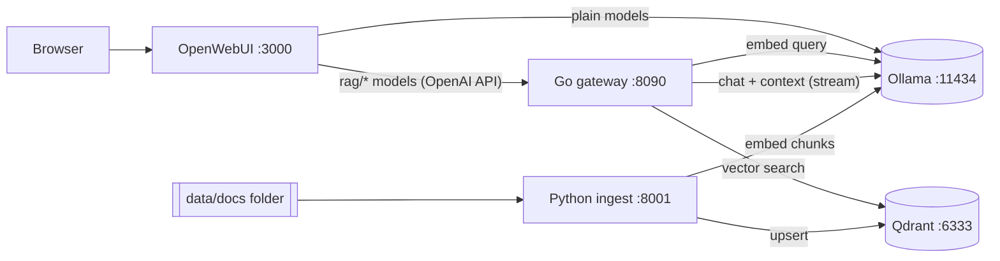

# sh-rag — self-hosted RAG with OpenWebUI + Ollama

A local, private retrieval-augmented chat stack that runs the same on **Windows** and **macOS**.

- **OpenWebUI** is the chat interface.
- **Ollama** runs the chat and embedding models.
- **Go gateway** (`gateway/`) is the hot path for every chat message. It is an OpenAI-compatible API that embeds the question, searches Qdrant, injects the best passages into the prompt, and streams the answer from Ollama, with a sources list. It uses only the standard library and a pooled HTTP transport, and streams in a single pass with no buffering.
- **Python ingest** (`ingest/`) handles document processing, where Python's parsing ecosystem shines. It parses PDF, DOCX, HTML, Markdown, text and code, chunks and embeds them, and stores them in Qdrant. It watches a folder and also accepts uploads.
- **Qdrant** is the vector database.



## Prerequisites

| | Windows 10/11 | macOS (Apple Silicon or Intel) |
|---|---|---|
| Docker | Docker Desktop (WSL2 backend) | Docker Desktop or OrbStack |
| Ollama | [ollama.com/download](https://ollama.com/download) (uses NVIDIA/AMD GPU natively) | [ollama.com/download](https://ollama.com/download) (uses Metal) |

Ollama runs **natively on the host by default**. Docker on macOS has no GPU access, so a containerized Ollama there would be CPU-only and slow. If you'd rather not install Ollama, the stack can run it in Docker (see below).

## Quick start

**Windows (PowerShell)**
```powershell
.\scripts\start.ps1
# no native Ollama?            .\scripts\start.ps1 -DockerOllama
# Ollama in Docker on NVIDIA:  .\scripts\start.ps1 -DockerOllama -Gpu
```
If scripts are blocked, run `Set-ExecutionPolicy -Scope CurrentUser RemoteSigned` once.

**macOS**
```bash
bash scripts/start.sh
# or without native Ollama:    bash scripts/start.sh --docker-ollama
```

The script does four things:

1. Creates `.env` from `.env.example`.
2. Pulls `EMBED_MODEL` (default `bge-m3`) and `CHAT_MODEL` (default `qwen2.5:7b`).
3. Builds the Go and Python services.
4. Starts everything.

Then:

1. Drop documents into `data/docs/`. Subfolders are fine. The ingest service picks up new, changed and deleted files within `SCAN_INTERVAL` seconds.
2. Open **http://localhost:3000** and create the admin account on first visit.
3. Choose a model named **`rag/<model>`** to chat over your documents. Plain Ollama models without the prefix still work as normal, non-RAG chat.

Stop with `scripts/stop.ps1` / `scripts/stop.sh`. Add `-Purge` / `--purge` to also delete the vector index and the OpenWebUI data.

## Managing documents

| Action | How |
|---|---|
| Add | Copy files into `data/docs/`, or `curl -F "files=@report.pdf" http://localhost:8001/documents` |
| List | `curl http://localhost:8001/documents` |
| Remove | Delete the file, or `curl -X DELETE http://localhost:8001/documents/<doc_id or source path>` |
| Re-index | `scripts/reindex.ps1` / `scripts/reindex.sh` (`--force` re-embeds everything) |
| Inspect retrieval | `curl -H "Authorization: Bearer sh-rag-local-key" -d '{"query":"...","top_k":5}' http://localhost:8090/v1/retrieve` |

Interactive API docs for ingest: http://localhost:8001/docs. Uploaded files are saved under `data/docs/uploads/`, so they survive a re-index.

## Configuration

All settings are in `.env`. See [.env.example](.env.example) for the full list.

| Variable | Default | Notes |
|---|---|---|
| `CHAT_MODEL` | `qwen2.5:7b` | Pulled by the start script. Every installed chat model shows up as `rag/<name>`. |
| `EMBED_MODEL` | `bge-m3` | Multilingual (Korean/English). **Changing it requires** `reindex --recreate`. |
| `DOCS_PATH` | `./data/docs` | Any host folder, e.g. `C:/Users/me/Documents/kb` or `~/Documents/kb`. |
| `RAG_TOP_K` | `5` | Passages per question. |
| `RAG_SCORE_THRESHOLD` | `0.35` | Minimum cosine similarity. Lower it if answers miss context. |
| `CHUNK_SIZE` / `CHUNK_OVERLAP` | `1000` / `150` | In characters. Re-index after changing them. |
| `RAG_SHOW_SOURCES` | `true` | Appends a **Sources** list to answers. |
| `GATEWAY_API_KEY` | `sh-rag-local-key` | Shared secret between OpenWebUI and the gateway. |
| `WEBUI_PORT`, `GATEWAY_PORT`, `INGEST_PORT`, `QDRANT_PORT` | 3000, 8090, 8001, 6333 | Host ports, all bound to `127.0.0.1`. |

All ports are bound to localhost only. Before exposing anything on a network, change `GATEWAY_API_KEY` and `WEBUI_SECRET_KEY`.

## How a question is answered

1. OpenWebUI sends the conversation to the gateway as `rag/qwen2.5:7b`.
2. The gateway embeds the latest user message with `EMBED_MODEL` and runs a Qdrant search, keeping results with `score ≥ threshold` up to `top_k`.
3. It adds the numbered passages as a system message after any system prompt you set in OpenWebUI, then forwards the request to Ollama.
4. The response streams straight through. A **Sources** chunk is inserted just before the stream ends.

If retrieval fails (for example, Qdrant is down), the gateway logs a warning and answers without context instead of erroring. OpenWebUI's background tasks (title, tag and follow-up generation, which start with `### Task:`) skip retrieval.

## Development

Neither Go nor Python is needed on the host; everything builds in containers. To run the tests:

```bash
# Go gateway
docker run --rm -v "$PWD/gateway:/src" -w /src golang:1.23-alpine go test ./...
# Python ingest
docker run --rm -v "$PWD/ingest:/src" -w /src python:3.12-slim sh -c "pip install -q '.[dev]' && pytest -q"
```
On Windows PowerShell, use `${PWD}` in place of `$PWD`.

To run locally without Docker:

- **Gateway:** `cd gateway && go run ./cmd/gateway`. It reads `OLLAMA_BASE_URL`, `QDRANT_URL`, etc. and defaults to localhost.
- **Ingest:** `cd ingest && pip install -e ".[dev]" && python -m ingest serve`. The CLI also has `scan`, `add`, `list` and `remove`.

Layout:

```
gateway/   Go: cmd/gateway (main), internal/{config,ollama,qdrant,rag,server}
ingest/    Python: ingest/{loaders,chunker,embedder,store,pipeline,api,cli}.py, tests/
scripts/   start / stop / reindex for PowerShell and bash
docker-compose.yml, compose.gpu.yml, .env.example
```

## Troubleshooting

- **No `rag/*` models in OpenWebUI.** OpenWebUI saves its connection settings in its own database on first start. After that, the `OPENAI_API_*` env vars are ignored. Check *Admin Panel → Settings → Connections*: the OpenAI API entry should be `http://gateway:8080/v1` with your `GATEWAY_API_KEY`. Also check `docker compose logs gateway`.
- **"Ollama is not reachable".** Start the Ollama app (look for the tray or menu bar icon), or use the Docker Ollama option. On Docker Desktop, `host.docker.internal` reaches the host's `localhost:11434`. With Colima, set `OLLAMA_BASE_URL=http://host.lima.internal:11434`.
- **Port already in use.** Change the matching `*_PORT` in `.env`.
- **Dimension mismatch error after changing `EMBED_MODEL`.** Run `scripts/reindex.ps1 -Recreate` / `scripts/reindex.sh --recreate`.
- **Scanned PDFs produce no text.** These are images, not text. OCR them first (e.g. with `ocrmypdf`).
- **Answers ignore the documents.** Call `/v1/retrieve` with the question. If nothing comes back, lower `RAG_SCORE_THRESHOLD`. If the right passage comes back but the answer is still wrong, try a larger chat model.
