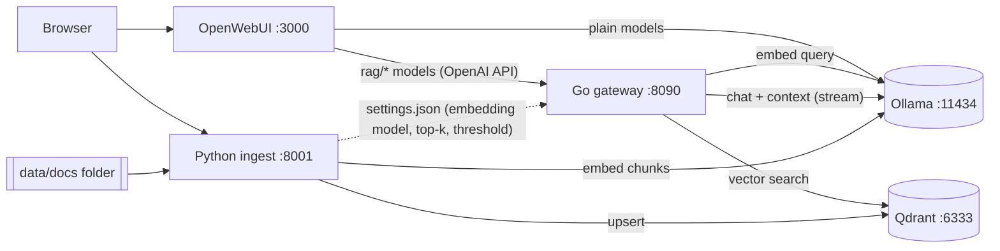

# sh-rag — self-hosted RAG with OpenWebUI + Ollama

A local, private retrieval-augmented chat stack that runs the same on **Windows** and **macOS**.

- **OpenWebUI** is the chat interface.
- **Ollama** runs the chat and embedding models.
- **Go gateway** (`gateway/`) is the hot path for every chat message. It is an OpenAI-compatible API that embeds the question, searches Qdrant, injects the best passages into the prompt, and streams the answer from Ollama, with a sources list. It uses only the standard library and a pooled HTTP transport, and streams in a single pass with no buffering.
- **Python ingest** (`ingest/`) handles document processing, where Python's parsing ecosystem shines. It parses PDF, DOCX, HTML, Markdown, text and code, chunks and embeds them, and stores them in Qdrant. It watches a folder, accepts uploads, serves the **web console** for documents, models and retrieval settings, and stores the **board and conversations** of native clients.
- **Qdrant** is the vector database.



## Prerequisites

| | Windows 10/11 | macOS (Apple Silicon or Intel) |
|---|---|---|
| Docker | Docker Desktop (WSL2 backend) | Docker Desktop or OrbStack |
| Ollama | [ollama.com/download](https://ollama.com/download) (uses NVIDIA/AMD GPU natively) | [ollama.com/download](https://ollama.com/download) (uses Metal) |

Ollama runs **natively on the host by default**. Docker on macOS has no GPU access, so a containerized Ollama there would be CPU-only and slow. If you'd rather not install Ollama, the stack can run it in Docker (see below).

## Quick start

**Windows (PowerShell)**
```powershell
.\scripts\start.ps1
# no native Ollama?            .\scripts\start.ps1 -DockerOllama
# Ollama in Docker on NVIDIA:  .\scripts\start.ps1 -DockerOllama -Gpu
```
If scripts are blocked, run `Set-ExecutionPolicy -Scope CurrentUser RemoteSigned` once.

**macOS**
```bash
bash scripts/start.sh
# or without native Ollama:    bash scripts/start.sh --docker-ollama
```

The script does four things:

1. Creates `.env` from `.env.example`.
2. Pulls `EMBED_MODEL` (default `bge-m3`) and `CHAT_MODEL` (default `qwen2.5:7b`).
3. Builds the Go and Python services.
4. Starts everything.

Then:

1. Open the **console at http://localhost:8001** and drag documents onto it, or copy them into `data/docs/`. Subfolders are fine.
2. Open **OpenWebUI at http://localhost:3000** and create the admin account on first visit.
3. Choose a model named **`rag/<model>`** to chat over your documents. Plain Ollama models without the prefix still work as normal, non-RAG chat.

Stop with `scripts/stop.ps1` / `scripts/stop.sh`. Add `-Purge` / `--purge` to also delete the vector index and the OpenWebUI data.

## Console (http://localhost:8001)

A small web console for everything outside of chatting:

| Tab | What you can do |
|---|---|
| **Documents** | Drag and drop files to embed them. Search the list of indexed documents and delete them. **Sync folder** picks up changes now instead of on the next scan. **Re-embed all** rebuilds every document from scratch. |
| **Models** | Download Ollama models (suggestions come from the public library at ollama.com as you type, with chat and embedding models kept apart; offline, a built-in list is used), delete them, and **switch the embedding model**. Each download shows a progress bar with bytes, speed and time left, and can be **cancelled and resumed**: Ollama keeps the layers already downloaded, so resuming continues where it stopped. |
| **Retrieval** | Change the number of passages per question and the minimum similarity, then **test a search** to see exactly what a question retrieves. |

The status bar shows whether Ollama and Qdrant are reachable and which embedding model is active.

**Switching the embedding model.** The new model is downloaded if needed, and every document is embedded into a *separate* Qdrant collection, one per model (e.g. `documents_bge_m3`). This runs in the background, and chat keeps using the old index until the new one is complete; then the gateway switches over automatically. Old indexes are kept, so switching back takes about a second.

**Choosing a chat model.** Pick one per conversation in OpenWebUI's model selector. Any chat model downloaded in the console appears there as `rag/<name>` automatically.

Settings changed in the console are saved to `data/config/settings.json`. The gateway re-reads that file within a second, so no restart is needed. Values in that file take precedence over `EMBED_MODEL`, `RAG_TOP_K` and `RAG_SCORE_THRESHOLD` in `.env`, which act only as initial defaults.

## Managing documents from the command line

Everything in the console is also available as an API (interactive docs at http://localhost:8001/docs) and from the CLI:

| Action | How |
|---|---|
| Add | Copy files into `data/docs/`, or `curl -F "files=@report.pdf" http://localhost:8001/documents` |
| List | `curl http://localhost:8001/documents` |
| Remove | Delete the file, or `curl -X DELETE http://localhost:8001/documents/<doc_id or source path>` |
| Re-index | `scripts/reindex.ps1` / `scripts/reindex.sh` (`--force` re-embeds everything) |
| Switch embedding model | `docker compose exec ingest python -m ingest embedding nomic-embed-text` |
| Download a model | `curl -d '{"model":"qwen2.5:7b"}' -H "Content-Type: application/json" http://localhost:8001/models/pull` → returns a job; follow it at `/jobs/<id>`, stop it with `POST /jobs/<id>/cancel` |
| Inspect retrieval | `curl -H "Authorization: Bearer sh-rag-local-key" -d '{"query":"...","top_k":5}' http://localhost:8090/v1/retrieve` |

Uploaded files are saved under `data/docs/uploads/`, so they survive a re-index.

## Native clients (iOS app and others)

The stack has a documented, versioned API for clients such as **sh-rag-client** for iOS:
**[docs/client-api.md](docs/client-api.md)**. In short:

- **Chat** uses the gateway's OpenAI-compatible endpoint with a small `sh_rag` extension:
  `"sh_rag": {"sources": "json"}` returns the retrieved passages as structured data (document id,
  title, page, score, text) in the first stream event, before the first token, instead of a markdown
  footer. `retrieve`, `top_k` and `score_threshold` can be set per request. `GET /v1/models` carries
  parameter size and quantization for each model.
- **Dashboard** data comes from `GET /stats` (totals, by type, indexes), and `GET /events` is a
  Server-Sent Events feed of job progress and board or conversation changes, so clients do not poll.
  `GET /documents/{key}` returns a document's passages and `GET /files/{source}` the original file.
- **Board** (kanban) and **conversations** are stored on the server (`/board`, `/conversations`),
  in `data/workspace/workspace.db`, so cards and chat history are shared between devices and
  survive reinstalls.
- **Discovery**: `GET /healthz` (gateway) and `GET /status` (ingest) list the supported `features`.

To reach the stack from a phone, set `BIND_ADDRESS=0.0.0.0` in `.env` together with a new
`GATEWAY_API_KEY` and an `INGEST_API_KEY`. The console asks for the ingest key once and remembers it.

## Configuration

All settings are in `.env`. See [.env.example](.env.example) for the full list.

| Variable | Default | Notes |
|---|---|---|
| `CHAT_MODEL` | `qwen2.5:7b` | Pulled by the start script. Every installed chat model shows up as `rag/<name>`. |
| `EMBED_MODEL` | `bge-m3` | Initial embedding model; multilingual (Korean/English). Switch later in the console. |
| `DOCS_PATH` | `./data/docs` | Any host folder, e.g. `C:/Users/me/Documents/kb` or `~/Documents/kb`. |
| `RAG_TOP_K` | `5` | Initial passages per question (adjustable in the console). |
| `RAG_SCORE_THRESHOLD` | `0.35` | Initial minimum cosine similarity (adjustable in the console). |
| `QDRANT_COLLECTION` | `documents` | Collection name prefix; the model name is appended (e.g. `documents_bge_m3`). |
| `CHUNK_SIZE` / `CHUNK_OVERLAP` | `1000` / `150` | In characters. Re-index after changing them. |
| `RAG_SHOW_SOURCES` | `true` | Appends a **Sources** list to answers. |
| `GATEWAY_API_KEY` | `sh-rag-local-key` | Shared secret between OpenWebUI (and native clients) and the gateway. |
| `INGEST_API_KEY` | empty | Optional bearer token for the ingest API and console. Empty keeps it open (localhost only). |
| `BIND_ADDRESS` | `127.0.0.1` | Interface the gateway, ingest API and OpenWebUI are published on. `0.0.0.0` makes them reachable from other devices. |
| `WEBUI_PORT`, `GATEWAY_PORT`, `INGEST_PORT`, `QDRANT_PORT` | 3000, 8090, 8001, 6333 | Host ports. Qdrant is always bound to `127.0.0.1`. |
| `WORKSPACE_PATH` | `./data/workspace` | Host folder for the board and conversations database. |

By default everything is bound to localhost. Before setting `BIND_ADDRESS=0.0.0.0`, change `GATEWAY_API_KEY` and `WEBUI_SECRET_KEY` and set `INGEST_API_KEY`.

## How a question is answered

1. OpenWebUI sends the conversation to the gateway as `rag/qwen2.5:7b`.
2. The gateway embeds the latest user message with `EMBED_MODEL` and runs a Qdrant search, keeping results with `score ≥ threshold` up to `top_k`.
3. It adds the numbered passages as a system message after any system prompt you set in OpenWebUI, then forwards the request to Ollama.
4. The response streams straight through. A **Sources** chunk is inserted just before the stream ends.

If retrieval fails (for example, Qdrant is down), the gateway logs a warning and answers without context instead of erroring. OpenWebUI's background tasks (title, tag and follow-up generation, which start with `### Task:`) skip retrieval.

## Development

Neither Go nor Python is needed on the host; everything builds in containers. To run the tests:

```bash
# Go gateway
docker run --rm -v "$PWD/gateway:/src" -w /src golang:1.23-alpine go test ./...
# Python ingest
docker run --rm -v "$PWD/ingest:/src" -w /src python:3.12-slim sh -c "pip install -q '.[dev]' && pytest -q"
```
On Windows PowerShell, use `${PWD}` in place of `$PWD`.

To run locally without Docker:

- **Gateway:** `cd gateway && go run ./cmd/gateway`. It reads `OLLAMA_BASE_URL`, `QDRANT_URL`, etc. and defaults to localhost.
- **Ingest:** `cd ingest && pip install -e ".[dev]" && python -m ingest serve`. The CLI also has `scan`, `add`, `list` and `remove`.

Layout:

```
gateway/   Go: cmd/gateway (main), internal/{config,ollama,qdrant,rag,server}
gateway/internal/settings  runtime settings shared with the console
ingest/    Python: ingest/{loaders,chunker,embedder,store,pipeline,runtime,ollama_api,library,jobs,api,cli}.py
ingest/ingest/{workspace,workspace_api,events}.py   board + conversations store, their routes, the SSE change feed
ingest/ingest/static/index.html   the web console (no build step, no external assets)
docs/client-api.md   the API contract for native clients
scripts/   start / stop / reindex for PowerShell and bash
docker-compose.yml, compose.gpu.yml, .env.example
```

## Troubleshooting

- **No `rag/*` models in OpenWebUI.** OpenWebUI saves its connection settings in its own database on first start. After that, the `OPENAI_API_*` env vars are ignored. Check *Admin Panel → Settings → Connections*: the OpenAI API entry should be `http://gateway:8080/v1` with your `GATEWAY_API_KEY`. Also check `docker compose logs gateway`.
- **"Ollama is not reachable".** Start the Ollama app (look for the tray or menu bar icon), or use the Docker Ollama option. On Docker Desktop, `host.docker.internal` reaches the host's `localhost:11434`. With Colima, set `OLLAMA_BASE_URL=http://host.lima.internal:11434`.
- **Port already in use.** Change the matching `*_PORT` in `.env`.
- **The console asks for an API key.** `INGEST_API_KEY` is set in `.env`; enter that value. It is remembered in the browser. Native clients send it as a Bearer token.
- **Embedding model switch failed.** The job card in the console shows the reason. A common one is that the model can't produce embeddings (it's a chat model). The previous model stays active, so nothing breaks.
- **Index looks corrupted.** Run `scripts/reindex.ps1 -Recreate` / `scripts/reindex.sh --recreate` to rebuild the active model's collection from the documents folder.
- **Scanned PDFs produce no text.** These are images, not text. OCR them first (e.g. with `ocrmypdf`).
- **Answers ignore the documents.** Try the question in the console's *Retrieval → Test a search*. If nothing comes back, lower `RAG_SCORE_THRESHOLD`. If the right passage comes back but the answer is still wrong, try a larger chat model.
